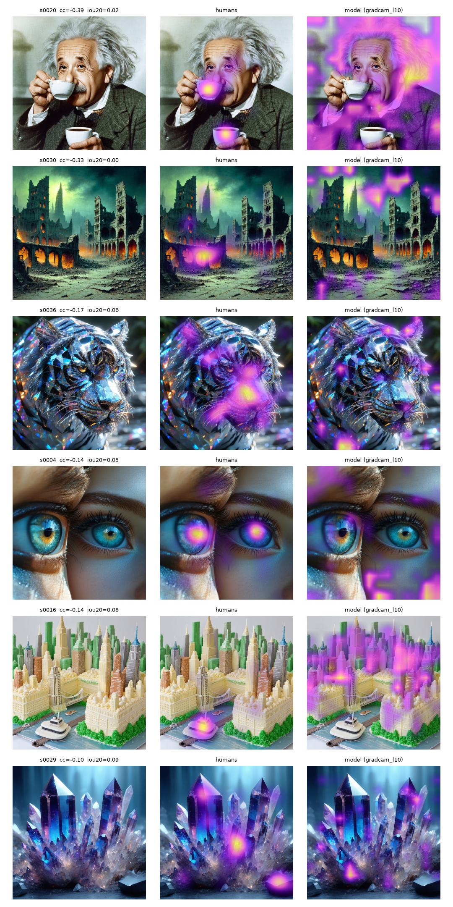
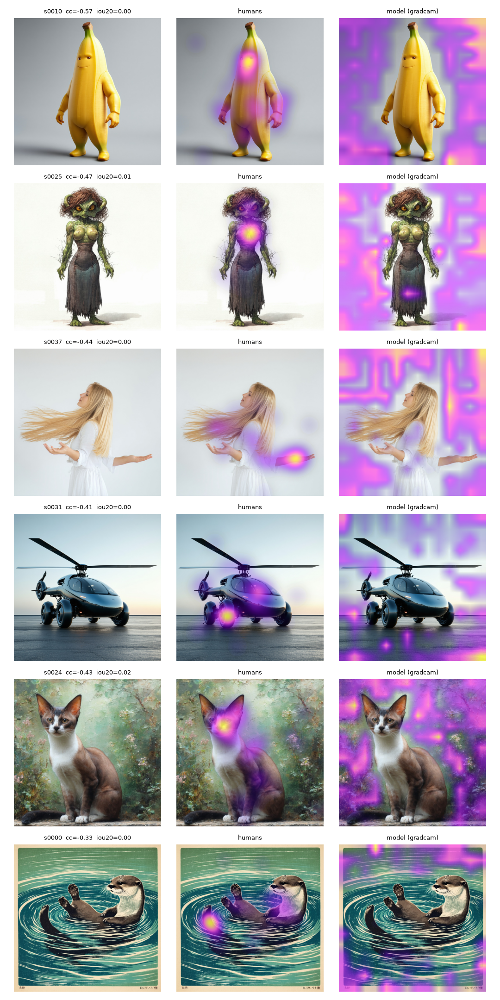
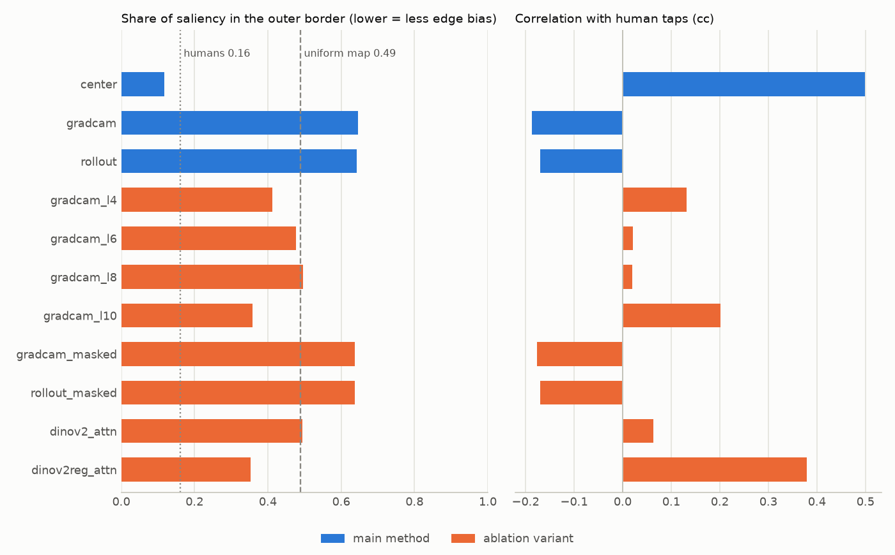

# Do humans look where the model looks?

Comparing **where people tap when asked to find glitches in AI-generated images** (via
[Rapidata](https://rapidata.ai)'s crowd) against **where a CLIP model's saliency lands** when asked
the same question. The disagreements are the interesting part.

> Status: complete for the offline study (40 images). Entirely cost-free: it uses only
> Rapidata's public dataset.

## Idea in one paragraph

Rapidata's Locate job asks real people to tap on visual artefacts in an image and returns the click
positions. Aggregating those clicks gives a human attention map. On the model side, Grad-CAM and
attention rollout on a CLIP vision tower, targeted at an "artefacts / glitches" text prompt, give a
model attention map. We score agreement per image (pointing game, IoU at the top-k% region,
correlation, NSS) and look at the tail: images where the crowd converges on a region the model
ignores, and vice versa.

## Data

Rapidata already published human artefact heatmaps in
[`Rapidata/text-2-image-Rich-Human-Feedback`](https://huggingface.co/datasets/Rapidata/text-2-image-Rich-Human-Feedback)
(`coherence_heatmap` column): crowd taps collected with the same kind of Locate task. All results
here use that dataset, so nothing costs money to reproduce. The repo can also run a fresh
(paid) Locate job through the Rapidata SDK; that path is implemented but was not used.

## Setup

```bash
conda create -n hvma python=3.12 pip && conda activate hvma
# Pick the torch build for your GPU first. cu126 still ships Pascal (GTX 10xx) kernels;
# newer CUDA builds dropped them. CPU-only also works (40 images take a few minutes).
pip install torch --index-url https://download.pytorch.org/whl/cu126
pip install -e ".[dev]"
pytest -q
```

Run every command from the repo root (config and data paths are relative). Fetching streams
the dataset and peaks at ~2.5 GB RAM.

## Reproduce

```bash
hvma fetch --n 40          # stream 40 samples from Hugging Face
hvma saliency              # CLIP Grad-CAM + attention rollout
hvma evaluate --human dataset
hvma report && hvma serve  # open http://127.0.0.1:8000
```

Optional live job — **costs money, not used for these results**. Needs a Rapidata account and
`RAPIDATA_CLIENT_ID` / `RAPIDATA_CLIENT_SECRET` in `.env` (copy `.env.example`):

```bash
hvma estimate              # prints the cost; charges nothing
hvma run --yes             # launches the Locate job and saves results/raw_locate.json
hvma parse-results results/raw_locate.json
hvma evaluate --human live
```

## Findings

40 images from the dataset, compared against the crowd's `coherence_heatmap`
(`results/summary.csv`, `results/ablation.csv`):

- **People tap on the subject, near the centre.** A model-free centre gaussian already reaches
  cc 0.50 and a pointing-game hit rate of 0.68. That is the bar any saliency method has to clear,
  and on this data none does.
- **Last-layer CLIP saliency is anti-correlated with people** (Grad-CAM cc −0.19, rollout −0.17;
  pointing 0.03, where a random map scores 0.10). 65% of its mass sits in the outer border of
  the image, versus 16% for the crowd. The bias belongs to the **last block**: one block earlier,
  Grad-CAM moves onto the subject (cc +0.20, pointing 0.42). Masking high-norm "artefact"
  tokens does not change it.
- **Registers fix attention in DINOv2** (cc 0.06 → 0.38, pointing 0.03 → 0.62). That map isn't
  prompt-conditioned, though: it finds the main object, not the glitch, and it still trails the
  centre prior. On these images, no CLIP or DINOv2 map localises glitches the way people do.

Caveats: 40 images; the dataset gives aggregated heatmaps rather than raw taps, so NSS (which
needs tap points) is not reported; one prompt pair and one CLIP model (ViT-B/16).

### Where humans and the model disagree most

Using Grad-CAM one block before the last (`gradcam_l10`), the variant that escapes the edge bias,
the six least-agreeing images show a real disagreement. Both look at the subject, but **people
flag local, logical errors** (a second cup, mismatched irises, a deformed ferry), while **Grad-CAM
picks texture-rich regions** (hair, a stormy sky, sparkles). CLIP's "artefact" direction seems
to track a global AI-art look more than the specific thing that is broken.



1. `s0020` *Einstein drinking coffee* — people tap the two cups (one at his mouth, one floating
   below); Grad-CAM lights his hair and jacket. The duplicated object is invisible to it.
2. `s0030` *dead city* — the crowd marks the fire-lit arches at lower left; Grad-CAM marks the
   sky and spires.
3. `s0036` *crystal tiger* — people tap the muzzle; Grad-CAM scatters over bokeh highlights and
   ear tips, which in a prismatic render look "glitchy" everywhere.
4. `s0004` *eyes* — people tap both irises (two mismatched eyes fused into one face); Grad-CAM
   marks the brow and a corner of skin.
5. `s0016` *cake shaped like New York* — people converge on the malformed ferry; Grad-CAM spreads
   over the skyline.
6. `s0029` *crystal screensaver* — the mildest case (cc −0.10): people tap the cluster's base and
   a stray rock, Grad-CAM the crystal tips. With a fully stylised subject, neither has an
   obvious error to find.

<details>
<summary>Same view for last-layer Grad-CAM: all edge bias</summary>



All six are the edge bias at work: people tap on the subject while Grad-CAM tiles the empty
background.

1. `s0010` *banana character* — face and stubby hands vs. the grey backdrop.
2. `s0025` *anthropomorphic Thwomp woman* — the torso's anatomy vs. the white background.
3. `s0037` *woman with flowing hair* — the outstretched hand vs. the empty wall.
4. `s0031` *helicopter with car wheels* — where car and helicopter fuse vs. tarmac and sky.
5. `s0024` *chakat* — oversized ears and face vs. painted foliage.
6. `s0000` *wood-cut otter* — the tail in the whirlpool vs. the print's frame.

</details>

### Edge-bias ablation (dataset heatmaps, 40 images)

Last-layer CLIP Grad-CAM and rollout put ~65% of their mass in the outer border of the image
(a uniform map: 49%; human taps: 16%) and end up *anti*-correlated with people. A model-free
centre gaussian (`center`) beats both by a wide margin, so every number here should be read
against it. Each ablation variant tests one explanation (`results/ablation.csv`):

| map | what it tests | cc | pointing | border mass |
|---|---|---|---|---|
| `center` | centre-bias baseline | **0.50** | **0.68** | 0.12 |
| `gradcam` | main method, last block | −0.19 | 0.03 | 0.65 |
| `gradcam_l10` / `l8` / `l6` / `l4` | earlier blocks | 0.20 / 0.02 / 0.02 / 0.13 | 0.42 / 0.30 / 0.25 / 0.38 | 0.36–0.50 |
| `gradcam_masked` | in-paint high-norm tokens | −0.18 | 0.03 | 0.64 |
| `dinov2_attn` | DINOv2 CLS attention | 0.06 | 0.03 | 0.49 |
| `dinov2reg_attn` | same, model trained with registers | 0.38 | 0.62 | 0.35 |

- The edge bias comes from the **last block**: one block earlier (`gradcam_l10`) the map moves
  onto the subject and correlates positively.
- **Masking high-norm tokens does nothing.** CLIP has ~10 of them per image, but only 7% sit in
  the border and 3% of Grad-CAM's top patches are outliers, so they are not what Grad-CAM sees.
- **Registers fix DINOv2.** Plain DINOv2 attention is spread evenly (border mass 0.49); the register
  variant lands on the subject. It isn't prompt-conditioned, so this is object-centric
  attention rather than glitch detection, and it still trails `center`.



## Notes

- Built with Claude Code; `CLAUDE.md` holds the working agreement.
- Not affiliated with Rapidata. Dataset and the images in the gallery:
  [`Rapidata/text-2-image-Rich-Human-Feedback`](https://huggingface.co/datasets/Rapidata/text-2-image-Rich-Human-Feedback),
  © Rapidata, Apache-2.0.
